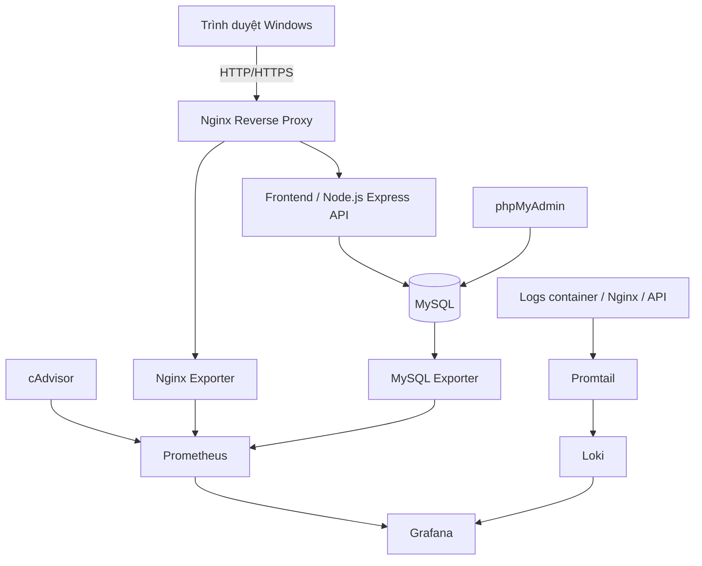

# MiniShop — Triển khai website thương mại điện tử với Docker Compose

> **Trạng thái: ĐANG PHÁT TRIỂN.** Đây là tài liệu khởi tạo dự án. Những mục đánh dấu **Dự kiến / Chưa kiểm thử** chưa được triển khai hoặc xác nhận chạy thành công. Cập nhật README sau từng mốc commit; không coi các lệnh dự kiến là kết quả demo.

## Thông tin đề tài

| Trường | Thông tin |
|---|---|
| Học phần | Triển khai và Quản trị Hệ thống Phần mềm |
| Đề tài | Đề 9 — Website Thương mại điện tử (E-commerce) |
| Họ tên sinh viên | `Pham Thi Nhung` |
| Mã số sinh viên | `DTC245160006` |
| Lớp | `KHMT 23A` |
| Giảng viên hướng dẫn | `Hoang van Tam` |
| GitHub repository | `https://github.com/nhungphamco/dtc245160006-Ecommerce` |
| Môi trường triển khai | VMware Workstation → Ubuntu Server 24.04 LTS → Docker Compose |

## 1. Giới thiệu

MiniShop là website thương mại điện tử mẫu, phục vụ thực hành triển khai và vận hành ứng dụng nhiều dịch vụ trên Linux. Phạm vi chức năng dự kiến:

- Hiển thị danh sách và chi tiết sản phẩm.
- Thêm, cập nhật số lượng và xóa sản phẩm khỏi giỏ hàng.
- Đặt hàng; lưu đơn hàng và dòng hàng vào MySQL.
- Quản trị dữ liệu bằng phpMyAdmin; xem và xử lý đơn hàng bằng giao diện hoặc API được xác thực.
- Truy cập ứng dụng qua Nginx reverse proxy.
- Theo dõi container, Nginx, MySQL qua Prometheus + Grafana.
- Thu thập và truy vấn log tập trung bằng Loki + Promtail theo yêu cầu đề bài.
- Áp dụng các biện pháp hardening có thể kiểm chứng.

**Ngoài phạm vi phiên bản đầu:** thanh toán thật, đăng ký/đăng nhập khách hàng, vận chuyển và tích hợp cổng thanh toán. Không lưu dữ liệu thẻ ngân hàng.

## 2. Yêu cầu bài tập và thang điểm

| Tiêu chí | Điểm tối đa | Minh chứng cần có | Trạng thái |
|---|---:|---|---|
| GitHub | 1.5 | Source + config + README; ít nhất 3 commit có ý nghĩa | ☐ |
| Ứng dụng + Database | 1.5 | Website hoạt động, ghi/đọc MySQL, phpMyAdmin | ☐ |
| Nginx reverse proxy | 1.5 | Truy cập website qua Nginx; HTTPS tự ký hoặc security headers | ☐ |
| Prometheus + Grafana | 1.5 | Targets `UP`, dashboards container/web/DB có dữ liệu | ☐ |
| Loki + Promtail | 1.5 | Logs tập trung; 2–3 truy vấn LogQL thành công | ☐ |
| Hardening | 1.5 | Tối thiểu 3–4 biện pháp bảo mật có minh chứng | ☐ |
| Tổng thể và demo | 1.0 | Toàn hệ thống chạy qua Compose; báo cáo và ảnh minh chứng | ☐ |
| **Tổng** | **10.0** | | |

Báo cáo tổng hợp tối thiểu **10 trang** (bìa chuẩn, kiến trúc, các bước triển khai, kết quả và hình minh họa).

## 3. Kiến trúc dự kiến



**Luồng nghiệp vụ:** trình duyệt → Nginx → web/API → MySQL. phpMyAdmin là công cụ quản trị DB riêng, không nằm trong luồng đặt hàng.

**Luồng quan sát:** cAdvisor và exporter cung cấp metrics để Prometheus thu thập (*pull*); Promtail đọc log và đẩy vào Loki (*push*); Grafana truy vấn Prometheus/Loki để trực quan hóa.

**Tách mạng dự kiến:** `proxy_net` cho Nginx ↔ backend; `db_net` cho backend ↔ MySQL và phpMyAdmin; `monitoring_net` cho Prometheus, exporter và Grafana; `logging_net` cho thành phần thu thập log. Các dịch vụ có thể tham gia nhiều mạng khi cần. Không publish cổng MySQL ra máy host.

## 4. Công nghệ

| Lớp | Công nghệ dự kiến |
|---|---|
| Frontend | HTML, CSS, JavaScript |
| Backend | Node.js LTS, Express, MySQL driver |
| Database | MySQL |
| DB admin | phpMyAdmin |
| Reverse proxy | Nginx |
| Container | Docker Engine + Docker Compose Plugin |
| Metrics | Prometheus, cAdvisor, Nginx Exporter, MySQL Exporter |
| Dashboard | Grafana |
| Logging | Loki + Promtail (theo đề) |
| Host | Ubuntu Server 24.04 LTS trong VMware Workstation |
| Điều khiển | SSH từ Windows PowerShell |

**Lưu ý về Promtail:** Grafana thông báo Promtail đã EOL từ **02/03/2026** và khuyến nghị chuyển sang Grafana Alloy. Vì đề bài yêu cầu Promtail, cần thống nhất với giảng viên: dùng Promtail có kiểm soát cho môi trường demo cô lập, hoặc dùng Alloy nếu được chấp thuận. Không khuyến nghị Promtail cho môi trường production.

## 5. Cấu trúc thư mục dự kiến

```text
MiniShop/
├── frontend/                 # HTML/CSS/JS giao diện bán hàng
├── backend/
│   ├── src/                  # API, truy cập DB, xử lý đơn hàng
│   ├── package.json
│   └── Dockerfile
├── database/
│   └── init.sql              # Schema và dữ liệu mẫu
├── nginx/
│   └── default.conf          # Reverse proxy + security headers
├── monitoring/
│   ├── prometheus/
│   │   └── prometheus.yml
│   ├── grafana/              # Provisioning datasource/dashboard
│   └── exporters/            # Cấu hình phụ nếu cần
├── logging/
│   ├── loki/
│   │   └── loki-config.yml
│   └── promtail/
│       └── promtail-config.yml
├── screenshots/              # Ảnh minh chứng demo (không chứa bí mật)
├── docs/                     # Sơ đồ, tài liệu bổ sung
├── compose.yaml
├── .env.example              # Mẫu biến môi trường; không có mật khẩu thật
├── .gitignore
└── README.md
```

> Đây là cấu trúc **mục tiêu**, chưa có nghĩa tất cả các file đã được tạo. Khi triển khai, cập nhật theo đúng cấu trúc thực tế.

## 6. Chuẩn bị môi trường

### 6.1. Máy thật Windows

- VMware Workstation đã cài đặt.
- Máy ảo **Ubuntu Server 24.04 LTS** mới; không dùng lại Ubuntu 18.04 cũ.
- Git trên Windows nếu viết code và commit từ Windows.
- PowerShell hoặc Windows Terminal có lệnh `ssh`.
- Trình duyệt để thử website, phpMyAdmin, Grafana.

### 6.2. Cấu hình VM tham khảo

- CPU: 4 vCPU; RAM: 6–8 GB tùy RAM máy thật; disk: khoảng 60 GB.
- Network: NAT của VMware; Windows thường SSH được IP máy ảo qua VMware VMnet8.
- Cài OpenSSH Server trong quá trình cài Ubuntu.
- Kiểm tra trên Ubuntu:

```bash
cat /etc/os-release
hostname -I
systemctl status ssh
```

Trên **Windows PowerShell** (thay user/IP thật):

```powershell
ssh <ubuntu_user>@<vm_ip>
```

**Không dùng lại địa chỉ IP cũ** `192.168.197.134` nếu VM mới nhận IP khác. Nên dùng IP thực tế từ `hostname -I`; có thể đặt DHCP reservation sau.

### 6.3. Cài Docker Engine trên Ubuntu (khi VM 24.04 đã sẵn sàng)

Chạy trong phiên SSH Ubuntu; theo hướng dẫn chính thức của Docker:

```bash
sudo apt update
sudo apt install -y ca-certificates curl
sudo install -m 0755 -d /etc/apt/keyrings
sudo curl -fsSL https://download.docker.com/linux/ubuntu/gpg -o /etc/apt/keyrings/docker.asc
sudo chmod a+r /etc/apt/keyrings/docker.asc

sudo tee /etc/apt/sources.list.d/docker.sources > /dev/null <<EOF_DOCKER
Types: deb
URIs: https://download.docker.com/linux/ubuntu
Suites: $(. /etc/os-release && echo "${UBUNTU_CODENAME:-$VERSION_CODENAME}")
Components: stable
Architectures: $(dpkg --print-architecture)
Signed-By: /etc/apt/keyrings/docker.asc
EOF_DOCKER

sudo apt update
sudo apt install -y docker-ce docker-ce-cli containerd.io docker-buildx-plugin docker-compose-plugin
sudo systemctl enable --now docker
sudo docker run --rm hello-world
sudo docker compose version
```

Để tiện và an toàn ở giai đoạn đầu, ví dụ dùng `sudo docker ...`. **Không tự động thêm tài khoản vào nhóm `docker` nếu chưa hiểu rằng nhóm này cấp quyền tương đương root trên host.**

Tham khảo: https://docs.docker.com/engine/install/ubuntu/

### 6.4. Lấy mã nguồn từ GitHub (sau khi tạo repository)

```bash
git clone <URL_REPOSITORY>
cd <TEN_THU_MUC_REPOSITORY>
```

Nếu thiếu Git: `sudo apt install -y git`.

## 7. Cấu hình và chạy hệ thống — dự kiến, CHƯA KIỂM THỬ

> **Chỉ làm mục này khi đã tồn tại `compose.yaml`, Dockerfile, Nginx config, script SQL và file cấu hình metrics/logging đúng như repository.** README khởi tạo chưa cung cấp đầy đủ các file đó.

1. Tạo `.env` từ mẫu và đặt mật khẩu riêng:

   ```bash
   cp .env.example .env
   nano .env
   ```

   Dự kiến các khóa cần khai báo (tên chính xác sẽ được đồng bộ với `compose.yaml`):

   ```dotenv
   MYSQL_DATABASE=minishop
   MYSQL_USER=minishop_app
   MYSQL_PASSWORD=CHANGE_ME_STRONG_APP_PASSWORD
   MYSQL_ROOT_PASSWORD=CHANGE_ME_STRONG_ROOT_PASSWORD
   GRAFANA_ADMIN_USER=admin
   GRAFANA_ADMIN_PASSWORD=CHANGE_ME_STRONG_GRAFANA_PASSWORD
   ```

   **Không dùng các giá trị `CHANGE_ME...` để chạy thực tế. Không commit `.env` hoặc chứng thực thật.**

2. Kiểm tra và khởi động:

   ```bash
   sudo docker compose config
   sudo docker compose up -d --build
   sudo docker compose ps
   sudo docker compose logs --tail=100
   ```

3. Kiểm tra container lỗi (nếu có):

   ```bash
   sudo docker compose logs --tail=200 backend
   sudo docker compose logs --tail=200 mysql
   sudo docker compose logs --tail=200 nginx
   ```

4. Dừng các dịch vụ, vẫn giữ dữ liệu volume:

   ```bash
   sudo docker compose down
   ```

**Không dùng `docker compose down -v` nếu muốn giữ dữ liệu MySQL/Grafana/Prometheus/Loki**: tùy cấu hình, lệnh này xóa các named volumes.

### Địa chỉ truy cập dự kiến

| Thành phần | Ví dụ URL từ Windows | Ghi chú |
|---|---|---|
| Website | `http://<vm_ip>:8080` | Dự kiến publish từ Nginx |
| phpMyAdmin | `http://localhost:8081` | Chỉ khi đã tạo SSH tunnel tương ứng |
| Grafana | `http://localhost:3000` | Chỉ khi đã tạo SSH tunnel tương ứng |
| Prometheus | `http://localhost:9090` | Chỉ khi đã tạo SSH tunnel tương ứng |

Nên bind các công cụ quản trị vào `127.0.0.1` trên **host Ubuntu** và truy cập bằng SSH tunnel, không mở chúng ra toàn bộ LAN. Ví dụ, **sau khi** `compose.yaml` đã publish Grafana trên `127.0.0.1:3000:3000` của Ubuntu, mở một PowerShell riêng trên Windows:

```powershell
ssh -L 3000:127.0.0.1:3000 <ubuntu_user>@<vm_ip>
```

Sau đó mở `http://localhost:3000` trên Windows. Các port còn lại thực hiện tương tự và phải không xung đột với ứng dụng trên Windows.

## 8. Thiết kế Database dự kiến

- `products(id, name, description, price, stock, image_url)`.
- `orders(id, customer_name, customer_phone, total_amount, status, created_at)`.
- `order_items(id, order_id, product_id, quantity, unit_price)`.

Quan hệ: `orders` 1–N `order_items`; `products` 1–N `order_items`.

Giá ở `order_items.unit_price` lưu theo thời điểm tạo đơn. Backend phải lấy giá từ DB, không tin giá do client gửi lên. Dùng transaction khi ghi đơn + chi tiết đơn và cập nhật tồn kho để tránh lưu đơn dở dang.

## 9. API dự kiến

| Method | Endpoint | Chức năng | Trạng thái |
|---|---|---|---|
| GET | `/api/health` | Kiểm tra tình trạng backend | ☐ |
| GET | `/api/products` | Danh sách sản phẩm | ☐ |
| GET | `/api/products/:id` | Chi tiết sản phẩm | ☐ |
| POST | `/api/orders` | Tạo đơn hàng và lưu MySQL | ☐ |
| GET | `/api/orders` | Danh sách đơn hàng (yêu cầu xác thực admin) | ☐ |

Không công khai API quản trị khi chưa có cơ chế xác thực/ủy quyền. Tất cả input cần kiểm tra và SQL phải dùng truy vấn tham số hóa.

## 10. Kế hoạch Git commits

Bài yêu cầu **tối thiểu 3 commit có ý nghĩa**. Có thể có thêm commit khởi tạo README; ba commit triển khai chính:

| Mốc | Nội dung bắt buộc | Commit message gợi ý | Trạng thái |
|---|---|---|---|
| 1 | Website + MySQL + phpMyAdmin + Nginx, HTTPS hoặc security headers | `feat: deploy ecommerce app with MySQL and Nginx` | ☐ |
| 2 | Prometheus + Grafana + exporters + dashboard | `feat: add Prometheus Grafana and exporters` | ☐ |
| 3 | Loki + Promtail + LogQL + hoàn thiện hardening | `feat: centralize logs and harden services` | ☐ |

Các lệnh Git điển hình **sau khi đã hoàn thiện và kiểm thử mốc tương ứng**:

```bash
git status
git add .
git commit -m "feat: deploy ecommerce app with MySQL and Nginx"
git push
```

Thay commit message ở mỗi mốc. Kiểm tra `.env`, chứng thực, log nhạy cảm và private key không nằm trong `git status` trước khi commit. Nếu đã lộ credential, phải thay mới chứ không chỉ xóa khỏi commit sau.

## 11. Giám sát — Commit 2 (chưa triển khai)

Dự kiến dùng **cAdvisor** giám sát container, **Nginx Exporter** cho web server, **MySQL Exporter** cho DB; Prometheus scrape các endpoint này; Grafana hiển thị dashboard. Nginx OSS có thể cần bật `stub_status` cho exporter, và MySQL Exporter cần tài khoản DB chỉ đủ quyền giám sát.

Các truy vấn PromQL kiểm tra minh họa (tên metrics cuối cùng phụ thuộc exporter/version):

```promql
up
```

```promql
container_memory_working_set_bytes
```

```promql
rate(nginx_http_requests_total[5m])
```

**Minh chứng:** Prometheus Targets `UP`, dashboard Grafana có CPU/RAM container, HTTP metrics và MySQL metrics; chụp màn hình sau khi tạo lưu lượng truy cập thử.

## 12. Logging — Commit 3 (chưa triển khai)

Nguồn log dự kiến: Nginx access/error, backend application, MySQL (mức phù hợp). Promtail thu thập và chuyển tiếp đến Loki; Grafana Explore kết nối datasource Loki. Label `job` trong ba truy vấn sau **phải được khai báo tương ứng trong cấu hình thu thập log**.

**LogQL 1 — toàn bộ log Nginx:**

```logql
{job="nginx"}
```

**LogQL 2 — lọc lỗi backend:**

```logql
{job="backend"} |~ "(?i)error|failed|exception"
```

**LogQL 3 — tổng số log Nginx theo cửa sổ 5 phút:**

```logql
sum(count_over_time({job="nginx"}[5m]))
```

**Minh chứng:** Loki datasource hoạt động; chạy từng LogQL trong Grafana Explore và chụp kết quả. Tạo traffic/log thử để tránh màn hình rỗng.

Tài liệu Promtail EOL: https://grafana.com/docs/loki/latest/send-data/promtail/

## 13. Hardening (chưa triển khai)

| Biện pháp | Phương án | Cách chứng minh |
|---|---|---|
| Non-root | Backend dùng `USER` không phải root | `sudo docker compose exec backend id` |
| Network isolation | Chia mạng proxy, DB, monitoring, logging | `sudo docker network ls` và `inspect` |
| DB least privilege | Tài khoản app khác root, chỉ cấp quyền cần thiết | `SHOW GRANTS FOR ...` |
| Mật khẩu và secret | Giá trị mạnh, `.env` không lên Git; cân nhắc Compose secrets | Kiểm tra cấu hình không lộ thông tin |
| Nginx security headers | `X-Content-Type-Options`, `X-Frame-Options`, `Referrer-Policy` | `curl -I http://<vm_ip>:8080` |
| Hạn chế cổng | MySQL không publish; admin UI bind loopback + tunnel | `sudo docker compose ps` |

**Ngoại lệ cần ghi nhận:** công cụ giám sát container đôi khi cần quyền đọc host/cgroup hoặc mounts đặc biệt; không tuyên bố mọi container non-root nếu chưa xác minh. Docker port publishing có thể tương tác với firewall theo cách không hiển nhiên; kiểm tra kỹ các cổng đã publish.

## 14. Checklist demo trước khi nộp

- [ ] SSH từ Windows tới Ubuntu Server 24.04 thành công.
- [ ] `sudo docker compose ps` cho thấy các dịch vụ cần thiết đang chạy/healthy.
- [ ] Website truy cập qua Nginx và có danh sách sản phẩm.
- [ ] Giỏ hàng, đặt hàng hoạt động; dữ liệu xuất hiện trong MySQL/phpMyAdmin.
- [ ] Nginx reverse proxy và security headers/HTTPS đã được chứng minh.
- [ ] Prometheus Targets `UP`, Grafana có metrics container/web/DB.
- [ ] Grafana Explore thực hiện được ít nhất 3 truy vấn LogQL.
- [ ] Chứng minh ít nhất 3–4 biện pháp hardening.
- [ ] Repository có đầy đủ source/config và >=3 commit triển khai có ý nghĩa.
- [ ] README đã cập nhật lệnh triển khai thực tế và các biến/cổng đúng.
- [ ] Chụp ảnh minh chứng và viết báo cáo >=10 trang.

### Danh sách ảnh nên lưu trong `screenshots/`

1. `01-github-commits.png`
2. `02-compose-ps.png`
3. `03-shop-products.png`
4. `04-order-success.png`
5. `05-phpmyadmin-order.png`
6. `06-nginx-headers.png`
7. `07-prometheus-targets.png`
8. `08-grafana-container.png`
9. `09-grafana-nginx-mysql.png`
10. `10-logql-nginx.png`
11. `11-logql-error.png`
12. `12-logql-count.png`
13. `13-hardening-evidence.png`

Không chụp màn hình chứa mật khẩu, `.env`, private key hoặc dữ liệu cá nhân thật.

## 15. Xử lý lỗi thường gặp

| Hiện tượng | Kiểm tra |
|---|---|
| SSH timeout | IP mới của VM, NAT VMnet8, firewall, `systemctl status ssh` |
| Docker không chạy | `sudo systemctl status docker`, `sudo journalctl -u docker -n 100` |
| Compose báo lỗi cấu hình | `sudo docker compose config` và `.env` |
| Website 502 | `sudo docker compose logs nginx backend`; kiểm tra upstream/service name |
| Backend không kết nối MySQL | DB healthcheck, hostname service `mysql`, user/password, network |
| Dashboard không có dữ liệu | Prometheus Targets, datasource URL, exporter, khoảng thời gian Grafana |
| Loki trả về rỗng | Promtail logs, đường dẫn đọc log, labels thực tế, thời gian truy vấn |
| Port already allocated | `sudo ss -ltnp` và các port trong `compose.yaml` |

## 16. Đề cương báo cáo

1. Bìa: thông tin trường/lớp/sinh viên/đề tài.
2. Mục lục, mục tiêu và yêu cầu.
3. Kiến trúc, luồng dữ liệu, Docker networks/volumes.
4. Triển khai web, MySQL, phpMyAdmin và Nginx.
5. Prometheus, exporters, Grafana và dashboard.
6. Loki, Promtail và ba truy vấn LogQL.
7. Các giải pháp hardening và bằng chứng.
8. GitHub, lịch sử commit, hướng dẫn chạy và demo.
9. Kết quả, hạn chế, đề xuất cải tiến, kết luận.

**Báo cáo ít nhất 10 trang**, dùng ảnh chụp thật từ dự án đã chạy; README không thay thế báo cáo.

## 17. Tài liệu tham khảo

- Docker Engine Ubuntu: https://docs.docker.com/engine/install/ubuntu/
- Docker Compose: https://docs.docker.com/compose/
- Ubuntu Server: https://ubuntu.com/server/docs
- Nginx: https://nginx.org/en/docs/
- Prometheus: https://prometheus.io/docs/
- Grafana: https://grafana.com/docs/grafana/latest/
- Loki và LogQL: https://grafana.com/docs/loki/latest/
- Promtail EOL: https://grafana.com/docs/loki/latest/send-data/promtail/

---

**Ghi chú cập nhật:** Sau mỗi commit, thay trạng thái ☐ bằng ✅ khi đã kiểm thử thực tế; cập nhật tên file, port, phiên bản image, sơ đồ, lệnh chạy, dashboard và ảnh minh chứng đúng với repository. Không ghi "hoàn thành" trước khi hệ thống chạy được.
