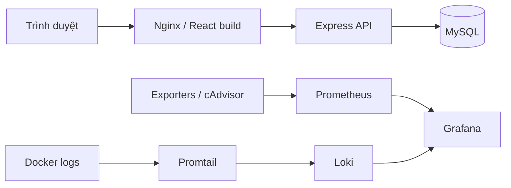

# MiniShop

Website thương mại điện tử mẫu phục vụ học phần **Triển khai và Quản trị Hệ thống Phần mềm**. Dự án triển khai React, Express và MySQL bằng Docker Compose trên Ubuntu, có Nginx reverse proxy, giám sát metrics và logging tập trung.

## Chức năng

- Xem sản phẩm, quản lý giỏ hàng và đặt hàng.
- Đăng ký, đăng nhập và xem thông tin tài khoản/đơn hàng.
- Quản trị sản phẩm, đơn hàng và khách hàng theo quyền admin.
- Quản trị database qua phpMyAdmin.
- Theo dõi hệ thống bằng Prometheus/Grafana; truy vấn log bằng Loki/Promtail.

Không tích hợp thanh toán hoặc vận chuyển thật.

## Công nghệ và kiến trúc

| Thành phần | Công nghệ |
|---|---|
| Frontend | React, Vite |
| Backend | Node.js, Express, mysql2, Argon2 |
| Database | MySQL 8.4 |
| Reverse proxy | Nginx |
| Container | Docker Engine, Docker Compose |
| Monitoring | Prometheus, Grafana, cAdvisor, node-exporter, Nginx/MySQL exporters |
| Logging | Loki, Promtail |



Hệ thống chia ba mạng `app_network`, `db_network`, `monitoring_network`. Công cụ quản trị bind loopback và truy cập qua SSH tunnel; MySQL không publish cổng host.

## Trạng thái

Cập nhật **21/10/2026**:

- Ứng dụng, Nginx, Prometheus/Grafana và Loki/Promtail đã chạy trên Ubuntu trong LAN.
- Năm target Prometheus UP; đã kiểm chứng log Nginx mới trên Grafana sau chuyển sang Promtail.
- Bộ cấu hình gồm **15 file Compose**, 12 container hoạt động; Alloy dừng có chủ đích để giữ phương án rollback.
- Đã áp dụng security headers, Origin guard/RBAC, log rotation và giới hạn tài nguyên cho một số service.
- Backup MySQL qua systemd lúc 02:00 giờ Việt Nam, retention giữ 7 bản hoàn tất; service chạy thủ công đã đạt và bản mới có checksum khớp ngoài VM. Lần chạy tự nhiên theo lịch chưa được xác minh.

**Chưa nghiệm thu toàn bộ:** cài mới và restore cô lập chưa được diễn tập; log Backend mới sau cutover chưa được kiểm chứng. HTTPS và một số finding bảo mật vẫn còn. Xem báo cáo tiến độ để biết phạm vi từng kết quả.

## Chuẩn bị và vận hành

Cần Ubuntu Server, Docker Engine/Compose, SSH và đủ tài nguyên cho các dịch vụ. VM lab hiện có khoảng 2 vCPU, 1.9 GiB RAM, 2 GiB swap; đây là môi trường hạn chế tài nguyên, chưa được kiểm thử chịu tải.

1. Chuẩn bị source, lockfiles và đủ bộ Compose/bind files theo runbook.
2. Trên môi trường mới, tạo `.env` từ `.env.example` khi chưa có file; đặt mật khẩu riêng, Origin tin cậy và thông tin SMTP nếu sử dụng.
3. Provision secret SMTP và thư mục state bên ngoài repository, với quyền phù hợp.
4. Chuẩn bị schema/migration hoặc restore theo kế hoạch riêng. Compose gốc chỉ mount `database/init.sql`; không tự chạy lại migration trên DB đang có dữ liệu.
5. Khai báo bộ 15 overlay đúng thứ tự theo runbook và validate trước khi triển khai.

**Chưa có Quick start cài mới đã kiểm chứng.** Không dùng riêng `compose.yaml` hoặc chạy lại script cutover để khởi động toàn hệ thống. Source Windows đã đủ 15 Compose file và source volume tương đối; secrets/state ngoài dự án vẫn phải provision riêng.

Các biến chính: `MYSQL_DATABASE`, `MYSQL_USER`, `MYSQL_PASSWORD`, `MYSQL_ROOT_PASSWORD`, `APP_ORIGIN`, `AUTH_ALLOWED_ORIGINS`, `MYSQL_EXPORTER_PASSWORD`, `GF_SECURITY_ADMIN_PASSWORD`. Cấu hình SMTP có trong `.env.example`; không commit `.env` thật.

Hướng dẫn đầy đủ về thứ tự overlay, kiểm tra chỉ đọc, cập nhật từng service và rollback: **`docs/security-operations.md`**. Tình trạng đồng bộ cấu hình: **`docs/compose-handoff-status.md`**.

## Truy cập

| Dịch vụ | Địa chỉ trên Ubuntu | Cách truy cập |
|---|---|---|
| Website | IP LAN của VM, cổng 80 | Trình duyệt qua Nginx |
| Grafana | `127.0.0.1:3000` | SSH tunnel |
| phpMyAdmin | `127.0.0.1:8081` | SSH tunnel |
| Prometheus | `127.0.0.1:9090` | SSH tunnel |
| Loki | `127.0.0.1:3100` | Grafana hoặc API nội bộ |

Ví dụ **Windows PowerShell** mở Grafana; thay user/IP theo môi trường, giữ cửa sổ SSH mở:

```powershell
ssh -N -o ExitOnForwardFailure=yes -L 127.0.0.1:13000:127.0.0.1:3000 <ubuntu_user>@<vm_ip>
```

Sau đó mở `http://127.0.0.1:13000`. phpMyAdmin dùng tài khoản MySQL, khác tài khoản SSH và admin ứng dụng.

## Kiểm tra nhanh

**Ubuntu Bash** — thay IP VM; không tạo hoặc thay đổi container:

```bash
curl --max-time 10 -sS -w '\nHTTP=%{http_code}\n' http://<vm_ip>/api/health
sudo docker ps -a --filter label=com.docker.compose.project=ecommerce --format 'table {{.Names}}\t{{.Status}}\t{{.Ports}}'
```

API mong đợi `HTTP=200`, database connected. Alloy `Exited (0)` là trạng thái dự kiến sau cutover.

PromQL trong Prometheus/Grafana:

```promql
{__name__=~"up|mysql_up|nginx_up"}
```

LogQL trong Grafana Explore, datasource Loki; chọn khoảng thời gian có log:

```logql
{service="nginx"}
```

```logql
sum by (status) (count_over_time({service="nginx"} | json | __error__="" [5m]))
```

Nếu No data, kiểm tra time range, labels và nguồn có phát sinh log mới không trước khi restart service. Nếu Grafana localhost từ chối kết nối, kiểm tra SSH tunnel.

## Bảo mật và dữ liệu

Môi trường lab hiện dùng HTTP. Một số container cần quyền root/host mounts; Docker socket mount RO không giới hạn quyền Docker API. Không coi cấu hình hiện tại là production-ready.

Promtail đã [EOL ngày 02/03/2026](https://grafana.com/docs/loki/latest/send-data/promtail/); dự án giữ Promtail theo lựa chọn cho bài lab.

Không đưa mật khẩu, token, cookie, SQL dump hoặc archive riêng tư vào Git. Checksum backup không thay thế restore test. Khi cập nhật cần backup và rollback riêng service; không xóa volume, reset database hoặc ghi đè `.env` đang vận hành.

## Tài liệu

| Tài liệu | Nội dung |
|---|---|
| `docs/security-operations.md` | Bộ Compose, vận hành và rollback |
| `docs/automated-backup.md` | Backup systemd, retention, bản sao ngoài VM và giới hạn |
| `docs/compose-handoff-status.md` | Đối chiếu cấu hình Ubuntu/Windows |
| `docs/promtail-transition.md` | Chuyển collector và giới hạn kiểm thử |
| `SECURITY_AUDIT_REPORT.md` | Static audit và phân loại findings |
| `SECURITY_RUNTIME_VERIFICATION_REPORT.md` | Kết quả runtime baseline trước khắc phục |
| `SECURITY_REMEDIATION_PROGRESS.md` | Thay đổi và bằng chứng mới nhất |

Báo cáo nghiệm thu và ảnh minh chứng được tập hợp riêng; README không thay thế báo cáo. Các tài liệu vận hành có thông tin môi trường lab, cần rà lại trước khi công khai repository.

## Thông tin học phần

- Sinh viên: **Pham Thi Nhung — DTC245160006**, lớp **KHMT 23A**.
- Giảng viên: **Hoang van Tam**.
- Đề tài: **Đề 9 — Website Thương mại điện tử**.
- Repository: https://github.com/nhungphamco/dtc245160006-Ecommerce
