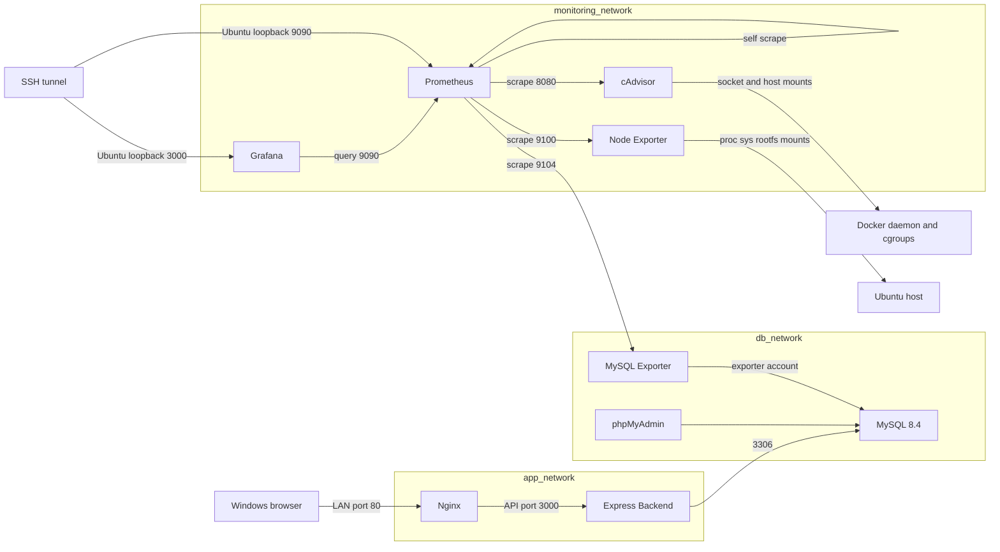

# MINISHOP — MONITORING TECHNICAL AUDIT

**Giai đoạn A — Static audit. Ngày: 19/10/2026, Asia/Saigon.**

Workspace: `D:\Ecommerce`. Môi trường đích theo người dùng: `/home/minishop/Ecommerce`, Ubuntu VMware, Docker Engine 29.9.1, Compose 5.6.0, systemd/cgroup v2, storage `overlayfs`, DockerRootDir `/var/lib/docker`, API 1.40–1.56. Các thông tin runtime này đến từ output/ngữ cảnh người dùng; không phải kết quả truy cập Ubuntu trong lần kiểm toán này.

## 1. Executive Summary

**Monitoring đã tồn tại trong workspace.** Đã đọc và phân tích hợp nhất **cả ba** file `compose.yaml`, `compose.nginx.yaml`, `compose.monitoring.yaml`. Kết quả có **9 service, 3 network, 3 named volume**, hợp lệ với Compose CLI Windows 5.5.1 khi dùng giá trị môi trường giả. Không tạo container, không đọc `.env`, không sửa source/config triển khai, không SSH hoặc truy vấn database thật. File mới duy nhất của nhiệm vụ là báo cáo này.

Các kết luận quan trọng:

1. **Không thể nghiệm thu container monitoring.** Người dùng báo cAdvisor target UP nhưng chỉ có series root `id="/"` và `count(container_last_seen)=1`. Đây là thiếu dữ liệu trước lớp dashboard; thay panel không thể tạo ra metrics container chưa tồn tại.
2. **Giả thuyết mạnh nhất là cAdvisor 0.49.1 không phù hợp đường metadata của storage hiện tại.** Đối chiếu mã upstream cho thấy phiên bản này đọc `image/<driver>/layerdb/mounts/.../mount-id` khi tạo Docker handler. Với storage `overlayfs`, lỗi người dùng nêu khớp nhánh mã đó. Chưa xác nhận trực tiếp storage snapshotter, đường socket/containerd và quyền filesystem trên Ubuntu, nên nguyên nhân host cuối cùng vẫn là **SUSPECTED**, không kết luận từ một dòng log.
3. **Cgroups v2/private namespace và các host mounts là nhánh điều tra riêng.** Chưa chứng minh thiếu privileged là nguyên nhân; không đề xuất bật `privileged: true` mặc định.
4. **Cấu hình credential MySQL Exporter không sai chỉ vì dùng environment.** v0.15.1 hỗ trợ `MYSQLD_EXPORTER_PASSWORD` cùng hai flag đang dùng. Nhưng phát hiện một vấn đề tương thích cụ thể: collector replication mặc định gọi SQL cũ đã bị MySQL 8.4 loại bỏ. Nó có thể thất bại trong khi `mysql_up=1`; chưa có output để xác nhận lỗi collector thực tế tại VM.
5. **Thiếu artefact dashboard:** không có thư mục provisioning dashboard hoặc JSON dashboard trong repo. Không thể kiểm toán từng panel/biến/UID của dashboard đang chạy chỉ từ datasource YAML.
6. **Chưa có Nginx Exporter/job/stub_status** trong source hiện tại, dù README yêu cầu giám sát web. Node Exporter không thay thế HTTP metrics của Nginx.
7. Tổng memory limit của năm service monitoring là **448 MiB**, nhưng chưa có số đo sau khi thêm monitoring. MySQL/Backend/phpMyAdmin không có memory limit trong Compose. Chưa có cơ sở nói hệ thống đã đủ RAM hoặc đang OOM.

### Quy ước bằng chứng

- **CONFIRMED:** có bằng chứng trong source/kiểm tra tĩnh/upstream. Nếu dựa trên người dùng, ghi rõ **CONFIRMED — user-reported**, chưa tái hiện độc lập.
- **SUSPECTED:** giả thuyết có căn cứ nhưng cần runtime để xác lập nguyên nhân.
- **NOT VERIFIED:** chưa có dữ liệu cần thiết. Không đồng nghĩa PASS hoặc FAIL.

Mức độ Critical/High/Medium/Low thể hiện tác động, không thay thế độ chắc chắn. **Chưa có phát hiện Critical đã chứng minh.** Không gán nhãn Critical chỉ vì một phiên bản cũ hoặc dashboard No data.

## 2. Inventory và các kiểm tra tĩnh đã thực hiện

### 2.1. File thực sự hiện có

| File/nhóm | Nội dung đã kiểm tra |
|---|---|
| [compose.yaml](D:/Ecommerce/compose.yaml:1) | MySQL, Backend, phpMyAdmin, DB credentials references, db_network, volume và ports. |
| [compose.nginx.yaml](D:/Ecommerce/compose.nginx.yaml:1) | Nginx/Frontend, Origin, mạng ứng dụng, hardening và resource limits. |
| [compose.monitoring.yaml](D:/Ecommerce/compose.monitoring.yaml:1) | Năm service monitoring, command, environment references, mount, network, ports, giới hạn và logging. |
| [prometheus.yml](D:/Ecommerce/monitoring/prometheus/prometheus.yml:1) | Global interval và bốn scrape job. |
| [datasource.yml](D:/Ecommerce/monitoring/grafana/provisioning/datasources/datasource.yml:1) | Provisioning một datasource Prometheus. |
| [nginx.conf](D:/Ecommerce/nginx/nginx.conf:1) | HTTP static/API, headers, log, healthz; không có metrics/status endpoint cho exporter. |
| [.env.example](D:/Ecommerce/.env.example:1) | Chỉ có biến DB/Auth; thiếu hai biến bắt buộc của monitoring. Đây là file mẫu, không phải `.env` thật. |
| [Frontend Dockerfile](D:/Ecommerce/frontend/Dockerfile:1), [Dockerfile.dockerignore](D:/Ecommerce/frontend/Dockerfile.dockerignore:1) | Nginx config được COPY vào image; đổi config trên host chưa tự đổi container. Có image HEALTHCHECK /healthz. |
| [Backend Dockerfile](D:/Ecommerce/backend/Dockerfile:1) | Non-root Node; không có instrumentation/monitoring image riêng. |
| [README.md](D:/Ecommerce/README.md:329), [nginx-deployment.md](D:/Ecommerce/docs/nginx-deployment.md:1) | Mục tiêu metrics và lịch sử triển khai; ghi nhận rollback overlay Nginx ngoài repo. |
| [MINISHOP_PROGRESS_REPORT.md](D:/Ecommerce/docs/MINISHOP_PROGRESS_REPORT.md:1), [bao-cao-hien-trang-du-an.md](D:/Ecommerce/docs/bao-cao-hien-trang-du-an.md:1) | Tài liệu lịch sử; không dùng kết luận monitoring cũ thay inventory mới. |
| [admin-phase-a.md](D:/Ecommerce/docs/admin-phase-a.md:1), [admin-phase-b.md](D:/Ecommerce/docs/admin-phase-b.md:1), [customer-account-phase-a.md](D:/Ecommerce/docs/customer-account-phase-a.md:1), [customer-account-phase-b.md](D:/Ecommerce/docs/customer-account-phase-b.md:1) | Bối cảnh ứng dụng và ranh giới fixture/DB thật; không có quy trình triển khai monitoring. |
| [test-backend-auth.sh](D:/Ecommerce/scripts/test-backend-auth.sh:1), [reset-admin-2-password.cjs](D:/Ecommerce/scripts/reset-admin-2-password.cjs:1) | Là công cụ Auth có thể ghi dữ liệu, không phải test monitoring; **không chạy**. |
| [.gitignore](D:/Ecommerce/.gitignore:1) | Bỏ qua `.env`, khóa, log và dữ liệu local; không chứng minh bí mật chưa từng xuất hiện ở nơi khác. |

**Không tồn tại trong workspace:** `monitoring/grafana/provisioning/dashboards/`; dashboard JSON trong `monitoring/` (0 file); script setup/grants/backup/test monitoring; tài liệu monitoring riêng trước báo cáo này; Dockerfile exporter riêng; cấu hình Nginx Exporter. `monitoring/exporters/` là thư mục rỗng. Các thư mục `logging/loki/`, `logging/promtail/` hiện rỗng.

Không có file `.my.cnf` monitoring được tham chiếu bởi Compose. Không suy ra credentials sai vì file này thiếu: exporter hiện dùng flag/environment hợp lệ. Không đọc database Grafana trên volume hoặc dashboard đã import bằng UI; chúng không có trong workspace.

### 2.2. Kiểm tra đã chạy và giới hạn

| Kiểm tra | Kết quả |
|---|---|
| Inventory, Git status, đọc file có số dòng | Đạt; không sửa Git/index. prometheus.yml đã staged từ trước; compose.monitoring.yaml và datasource directory hiện untracked. |
| Hợp nhất 2 file so với 3 file bằng `docker compose ... config --format json` | PASS; thêm monitoring không thay đổi định nghĩa bốn service ứng dụng trong bản Windows. mysql_data vẫn giữ nguyên. |
| Loại bỏ đọc dotenv | Dùng `--env-file NUL`, `COMPOSE_DISABLE_ENV_FILE=1`, cung cấp placeholder cho mọi biến bắt buộc; không xuất environment trong kết quả tóm tắt. |
| YAML Prometheus/datasource | PASS parse qua YAML parser của Compose bằng extension `x-audit-document` trong stdin, với service giả chỉ để parse. **Không tạo/pull container**. Kiểm tra thêm job trùng, địa chỉ target và cấu trúc datasource. |
| Prometheus-specific `promtool check config` | **Chưa chạy:** không có binary promtool local; không cài thêm hoặc tạo container trong A. YAML parse không thay thế promtool. |
| Grafana runtime/panel queries, exporter runtime, MySQL login | **Không chạy trong A**; để B sau phê duyệt. |

Không chạy lại test nghiệp vụ React/Express vì chúng không kiểm chứng cấu hình exporter hoặc dashboard. Không có test monitoring tự động hiện hữu để báo PASS.

### 2.3. Fingerprint của cấu hình đã kiểm toán

SHA256 dưới đây chỉ phục vụ nhận diện config, không chứa giá trị bí mật:

| File | SHA256 |
|---|---|
| compose.yaml | `0b55fa102ac1fcc94204b23afbab62abf102d4af68dd7a8aedb1b3174a6307a7` |
| compose.nginx.yaml | `439597e8800f14925982b3091ce9d9400e8815d6e15191399e544957c2674af5` |
| compose.monitoring.yaml | `6d2fa61213912d96e5caf36c3fd4838d0437ca3b1e60ce96ae51edd3f8e29bc8` |
| monitoring/prometheus/prometheus.yml | `687772c4c888f087b16ce13c00c6d1c5853b6d5dd3b8c3156c40c08eb1565a9b` |
| datasource.yml | `87a30bd480c525d53b551cc806f7f821bb4469dc619cbdbf177f839dff508a3f` |
| nginx/nginx.conf | `7e141ac2b4db76bb3e6963ceebf15c56589fc4dda9bad61c894e5e78d57c916b` |

Checksum Compose Ubuntu trong lịch sử là `96ffaa12...`, khác Windows vì Ubuntu dùng APP_ORIGIN literal. Cần so sánh semantic/line ending trước khi quy kết drift mới; không ghi đè bản Ubuntu bằng bản Windows để “làm khớp hash”.

## 3. Docker network và data flow

Đây là topology **cấu hình Windows hợp nhất**, chưa xác nhận network attachments runtime sau khi monitoring được triển khai. Nginx không nằm trên monitoring_network; chưa có đường thu thập HTTP metrics từ Nginx. mysql-exporter là service duy nhất của monitoring nối cả monitoring_network và db_network.

| Service | Image/config | Networks | Host bind | Memory limit |
|---|---|---|---|---:|
| mysql | mysql:8.4 | db_network | Không publish | Không đặt |
| backend | Build backend/Dockerfile | db_network, app_network | 127.0.0.1:3001 | Không đặt |
| phpmyadmin | phpmyadmin:5.2 | db_network | 127.0.0.1:8081 | Không đặt |
| nginx | minishop-frontend:nginx-v1 | app_network | 192.168.197.135:80 | 128 MiB |
| node-exporter | prom/node-exporter:v1.8.2 | monitoring_network | Không publish | 48 MiB |
| cadvisor | gcr.io/cadvisor/cadvisor:v0.49.1 | monitoring_network | Không publish | 80 MiB |
| mysql-exporter | prom/mysqld-exporter:v0.15.1 | monitoring_network, db_network | Không publish | 32 MiB |
| prometheus | prom/prometheus:v2.54.1 | monitoring_network | 127.0.0.1:9090 | 160 MiB |
| grafana | grafana/grafana-oss:11.4.0 | monitoring_network | 127.0.0.1:3000 | 128 MiB |

Tất cả service restart `unless-stopped`. MySQL có Compose healthcheck; Nginx có HEALTHCHECK trong Dockerfile/image dù `compose config` không hiển thị healthcheck kế thừa image. Năm service monitoring không có healthcheck khai báo tại Compose; healthcheck từ image cụ thể chưa inspect. `mysql-exporter` chờ MySQL healthy; Grafana chỉ chờ Prometheus started, không đảm bảo ready. Không có vòng lặp depends_on.

Các đường `./monitoring/...` resolve từ thư mục file Compose đầu tiên: Windows đã normalize thành `D:\Ecommerce\monitoring\...`; khi dùng các file trong `/home/minishop/Ecommerce` sẽ phải resolve đúng Ubuntu. `/proc`, `/sys`, `/var/lib/docker` và Docker socket là đường host Linux; parse trên Windows không chứng minh chúng có đúng mounts trên Ubuntu.

## 4. Bảng vấn đề theo mức độ

Mỗi hàng phân biệt bằng chứng với giả thuyết; “cách sửa” là đề xuất cho C, **chưa được thực hiện**.

| ID / mức độ / trạng thái | File và dòng | Triệu chứng, bằng chứng thực tế | Giả thuyết/nguyên nhân | Cần kiểm tra thêm | Cách sửa đề xuất | Rủi ro khi sửa |
|---|---|---|---|---|---|---|
| M01 — High — CONFIRMED user-reported; root cause SUSPECTED | [monitoring Compose:55](D:/Ecommerce/compose.monitoring.yaml:55) | cAdvisor UP nhưng chỉ root series; lỗi mount-id được người dùng báo. | Handler 0.49.1 dùng layout metadata cũ với Docker overlayfs. | DriverStatus, image digest, handler errors, socket/containerd và đường host thật. | Nếu xác nhận snapshotter: thử cAdvisor 0.56.2 với endpoint/mount đúng, giữ rollback. | Thêm quyền/socket, đổi labels, tăng RAM; nâng image đơn thuần có thể chưa đủ. |
| M02 — High — SUSPECTED | [monitoring Compose:60](D:/Ecommerce/compose.monitoring.yaml:60) | Không khai báo host cgroup namespace/rootfs; runtime private theo người dùng; mount /sys, Docker root, socket. | Namespace/mount visibility có thể là trở ngại độc lập. | So sánh host/container cgroup tree, denied messages, PID/rootfs resolution. | Sửa đúng mount/namespace được chứng minh cần thiết. | Mở rộng quyền quan sát host; không tự bật privileged. |
| M03 — High — CONFIRMED source; runtime impact NOT VERIFIED | [monitoring Compose:83](D:/Ecommerce/compose.monitoring.yaml:83), [MySQL image](D:/Ecommerce/compose.yaml:6) | Exporter v0.15.1 mặc định bật collector slave_status; SQL cũ không tương thích MySQL 8.4. | Collector có thể lỗi riêng dù mysql_up=1. | mysql_exporter_collector_success, log scraper, version DB thực. | Nếu không dùng replication, cân nhắc tắt riêng collector cũ; nếu cần thì chọn release hỗ trợ SQL mới sau đối chiếu. | Mất replication metrics nếu tắt; đổi version có thể đổi contract. |
| M04 — High — NOT VERIFIED | [monitoring Compose:85](D:/Ecommerce/compose.monitoring.yaml:85) | Không có bằng chứng mysql_up/login/grants; network/env mapping có trong source. | Sai secret, account host/plugin/quyền, DNS hoặc DB service có thể là nguyên nhân; chưa chứng minh. | Metric, lỗi kết nối, account match và quyền hiệu lực, chỉ kiểm tra secret có mặt. | Sửa đúng nhánh được xác nhận, không reset credential mù. | Thay grants/password có thể gián đoạn exporter hoặc cấp quá quyền. |
| M05 — High — CONFIRMED inventory; panel cause NOT VERIFIED | [Grafana mount](D:/Ecommerce/compose.monitoring.yaml:154) | Không có dashboard provisioning directory/JSON. Không kiểm toán được panel/Host/Container đang chạy. | Dashboard có thể import qua UI và nằm trong grafana_data. | Export dashboard JSON đã lọc thông tin nhạy cảm, UID, variables, Query Inspector. | Backup rồi version-control dashboard đã map đúng metric labels. | Provisioning đè thay đổi UI/UID nếu không giữ bản cũ. |
| M06 — Medium — CONFIRMED omission; impact SUSPECTED | [datasource:10](D:/Ecommerce/monitoring/grafana/provisioning/datasources/datasource.yml:10) | Datasource không khai báo UID hoặc scrape timeInterval. URL/network hợp lý. | UID/rate interval của dashboard nhập ngoài có thể lệch. Không có UID không phải lỗi syntax. | UID thực, datasource của từng panel, biến và khoảng rate. | Ghim UID sau khi đối chiếu; đặt interval phù hợp 30s. | Ghim UID mới mù có thể làm dashboard hiện có mất liên kết. |
| M07 — High theo phạm vi môn học — CONFIRMED | [prometheus.yml:11](D:/Ecommerce/monitoring/prometheus/prometheus.yml:11), [nginx.conf:37](D:/Ecommerce/nginx/nginx.conf:37) | Không có Nginx Exporter/job/stub_status; README có yêu cầu HTTP metrics. | Thiếu triển khai, không phải lỗi cAdvisor. | Xác minh runtime có config ngoài repo không. | Thêm endpoint nội bộ và exporter trong nhiệm vụ riêng sau chốt scope. | Rebuild Nginx, giới hạn truy cập endpoint; không public status. |
| M08 — Medium — SUSPECTED | [monitoring Compose:25](D:/Ecommerce/compose.monitoring.yaml:25) | Node Exporter có host paths, nhưng không host PID/network và root bind không rslave. | CPU/RAM có thể đúng; network/dynamic mount metrics có thể chưa đại diện đầy đủ host. | Đối chiếu CPU count, MemAvailable, root filesystem với host. | Điều chỉnh collector/mount propagation/namespace theo dữ liệu, không đổi network host mặc định. | Có thể expose 9100 hoặc tăng quyền nếu đổi host network thiếu listen restriction. |
| M09 — Medium — CONFIRMED budget; OOM NOT VERIFIED | [limits:35](D:/Ecommerce/compose.monitoring.yaml:35), [66](D:/Ecommerce/compose.monitoring.yaml:66), [96](D:/Ecommerce/compose.monitoring.yaml:96), [129](D:/Ecommerce/compose.monitoring.yaml:129), [161](D:/Ecommerce/compose.monitoring.yaml:161) | Tổng monitoring 448 MiB; Grafana128/Prom160/cAdvisor80 khá chặt, chưa có đo thực sau thêm metrics. | Discovery phục hồi làm tăng series/RAM; có thể OOM/throttle. | OOMKilled, RestartCount, RSS, CPU throttling, head_series, swap. | Đo rồi phân bổ lại hoặc giảm cardinality/collectors; cân nhắc tăng RAM VM khi cần. | Tăng tổng limit tùy tiện có thể làm host/MySQL thiếu RAM. |
| M10 — Medium — CONFIRMED | [retention:118](D:/Ecommerce/compose.monitoring.yaml:118), [base services](D:/Ecommerce/compose.yaml:5) | 3d/1GB retention, named volumes; ba service gốc không khai báo log rotation tại Compose. | 1GB không phải quota toàn bộ volume; WAL/compaction/images/log còn dùng disk. | df, docker system df, size WAL/volume/log, daemon log defaults. | Chọn retention theo dung lượng thực, rotation có kiểm soát, cảnh báo disk. | Giảm retention mất lịch sử; đổi logging có thể cần recreate service. |
| M11 — High — CONFIRMED exposure, compromise NOT VERIFIED | [socket mount:61](D:/Ecommerce/compose.monitoring.yaml:61) | cAdvisor được truy cập Docker socket dù bind :ro, có host filesystem mounts. | :ro không giới hạn Docker API thành chỉ đọc. | User/caps/permissions/socket/API cần thiết, mạng ai truy cập cAdvisor. | Giữ scope hẹp, audit quyền; proxy hạn chế API chỉ khi thử tương thích. | Proxy thiếu endpoint làm mất discovery; tăng privileges mở rộng tác động sự cố. |
| M12 — Medium — CONFIRMED | [.env.example:1](D:/Ecommerce/.env.example:1), [Compose env:86](D:/Ecommerce/compose.monitoring.yaml:86), [149](D:/Ecommerce/compose.monitoring.yaml:149) | File mẫu thiếu MYSQL_EXPORTER_PASSWORD và GF_SECURITY_ADMIN_PASSWORD bắt buộc. Không có script provisioning account. | Không tái lập được stack chỉ từ hướng dẫn/file mẫu. | Quy trình tạo secret/account hiện dùng, không xin giá trị. | Bổ sung tên biến và quy trình nhập kín/grants, không hardcode. | Lộ bí mật nếu dùng argv/config dump/commit nhầm. |
| M13 — Medium — CONFIRMED history; current drift NOT VERIFIED | [README:9](D:/Ecommerce/README.md:9), [overlay image:12](D:/Ecommerce/compose.nginx.yaml:12), [run comment](D:/Ecommerce/compose.monitoring.yaml:5) | Lịch sử Nginx có rollback overlay thứ tư ngoài repo; lệnh mới dùng ba file. | up toàn stack có thể đưa Nginx từ known-good về nginx-v1 hoặc áp dụng config khác. | Compose config_files/project labels, image IDs và config thực. | Chốt bộ file vận hành thống nhất; chỉ recreate service cần sửa. | Đổi thứ tự/file hoặc project name có thể recreate ngoài ý muốn/tạo volume mới. |
| M14 — Low/Medium — CONFIRMED Compose omission | [monitoring services](D:/Ecommerce/compose.monitoring.yaml:21) | Không có healthcheck Compose cho monitoring, Grafana depends_on started; không rule alert. | Process đang chạy dễ bị hiểu nhầm thành metrics đúng. | Image healthcheck, /-/ready, /api/health, up và collector metrics. | Healthchecks phù hợp, quality checks/alerts sau khi thu đúng dữ liệu. | Probe quá nặng gây tải; endpoint sống vẫn không chứng minh data đầy đủ. |
| M15 — Low — CONFIRMED | [README:329](D:/Ecommerce/README.md:329), Git inventory | README vẫn nói monitoring chưa triển khai; chỉ prometheus.yml được Git theo dõi/staged, các file mới còn untracked. | Tài liệu và artefact không đồng bộ workspace. | Đối chiếu bản Ubuntu và dashboard export. | Cập nhật tài liệu sau B/C, review trước commit được giao riêng. | Cập nhật sớm dễ báo hoàn thành sai; không commit secrets. |

## 5. Đối chiếu lỗi và phân tích nguyên nhân

### 5.1. cAdvisor: UP nhưng chỉ có root series

`up{job="cadvisor"}=1` chỉ chứng minh Prometheus scrape endpoint thành công. Theo thông tin người dùng, metric chỉ có `id="/"`; phần thiếu xảy ra trước Grafana. Config local không có `metric_relabel_configs` để loại series container, nhưng config Prometheus đang nạp trên Ubuntu vẫn phải đối chiếu.

Chuỗi suy luận: Docker nhận diện container → cAdvisor tạo handler → đọc cgroup/metadata → xuất series → Prometheus lưu → Grafana query. Một mắt xích handler hỏng vẫn có thể để endpoint HTTP và root metric hoạt động.

**Đối chiếu source thay vì suy đoán từ log:** cAdvisor v0.49.1 đọc `mount-id` rồi trả lỗi khỏi constructor nếu không đọc được; bước này đứng trước kiểm tra bật/tắt filesystem metrics. Vì thế tắt disk metrics không phải cách sửa đã chứng minh. Source có nhánh xử lý cgroup v2, nên nói phiên bản này “hoàn toàn không hỗ trợ cgroup v2” là không đúng. [Handler v0.49.1](https://raw.githubusercontent.com/google/cadvisor/v0.49.1/container/docker/handler.go).

Docker Engine 29 fresh install có thể dùng containerd image store; storage đó dùng snapshotter và layout khác graphdriver cổ điển. `overlayfs` là dấu hiệu phù hợp, nhưng cần DriverStatus và filesystem thực để xác nhận tại VM. Không đổi Docker storage driver/daemon.json để làm exporter cũ chạy. [Docker containerd image store](https://docs.docker.com/engine/storage/containerd/).

Về API: bản 0.49.1 có `WithAPIVersionNegotiation()`. Server hỗ trợ dải 1.40–1.56 theo output người dùng, nên không đủ căn cứ nói API chắc chắn bị từ chối hoặc ép DOCKER_API_VERSION để chữa lỗi. Cần log lỗi negotiation/inspect cụ thể. [Docker client v0.49.1](https://raw.githubusercontent.com/google/cadvisor/v0.49.1/container/docker/client.go).

Về namespace/mounts: Compose không đặt `cgroup: host`, không bind host root vào `/rootfs`, không có containerd socket. Trạng thái private/không privileged trong yêu cầu phù hợp với cấu hình nhưng chưa inspect trực tiếp ở A. Rootfs/PID/mount visibility có thể ảnh hưởng network/filesystem/handler; socket Docker mount sẵn không chứng minh cgroup tree đã nhìn thấy đủ. Chỉ bổ sung đúng quyền/mount khi B chứng minh cần thiết.

**Kết luận:** lỗi thiếu container series là CONFIRMED theo báo cáo người dùng; storage compatibility là SUSPECTED có căn cứ mạnh nhất. Namespace, mount permissions, OOM/PID limit và runtime config drift là các nhánh kiểm tra bổ sung. Dashboard variable mismatch có thể đồng thời tồn tại nhưng không giải thích việc Prometheus không có series container.

### 5.2. Grafana: datasource, biến và từng panel

Source có datasource `name=Prometheus`, `type=prometheus`, `access=proxy`, URL `http://prometheus:9090`, default và không cho sửa UI. Network của Grafana/Prometheus phù hợp. Không thấy lỗi hostname kiểu `localhost:9090` trong datasource.

Không đặt `uid` là hợp lệ: Grafana có thể tự sinh. Tuy nhiên, dashboard dùng UID cố định/import từ hệ thống khác cần được đối chiếu với UID thực. Không được kết luận thiếu UID tự nó gây No data. [Grafana provisioning](https://grafana.com/docs/grafana/latest/administration/provisioning/).

| Thành phần cần kiểm toán | Kết quả A |
|---|---|
| Dashboard UID, title/version và datasource UID từng panel | NOT VERIFIED — JSON không có trong workspace. |
| PromQL từng panel/refId, transformations, overrides | NOT VERIFIED — không tự giả định dashboard ID hoặc nội dung query. |
| Variables Host/Container: query, regex, current value, All value | Cảnh báo do người dùng báo; nguyên nhân cụ thể chưa có JSON/Query Inspector. |
| Labels job/instance | Từ config dự kiến: cadvisor/cadvisor:8080; node-exporter/node-exporter:9100; mysql-exporter/mysql-exporter:9104. Runtime phải kiểm tra. |
| Labels id/name/container/container_label_* | Không được giả định luôn có. `container` thường có thể là convention khác; cần sample series thực. |
| Time range, refresh, rate window | NOT VERIFIED. Với scrape30s, cửa sổ rate quá ngắn có thể thiếu mẫu; kiểm tra `$__rate_interval`, min interval và datasource scrape interval. |

Không xóa dashboard cũ. Khi có JSON, phân tích từng panel bằng cách chạy biểu thức gốc và biểu thức sau thay variables, so sánh label sets/datasource/time range. Nếu series nguồn đã thiếu thì sửa exporter trước, rồi mới sửa dashboard.

### 5.3. Prometheus

YAML parse thành công. `scrape_interval` và `evaluation_interval` đều 30s. Bốn job/address đúng service DNS trong topology static. Không khai báo scrape_timeout riêng, relabel/metric_relabel, rule_files, Alertmanager hoặc nginx job. Không có cấu hình filter trong repo giải thích việc chỉ giữ `id="/"`.

Datasource Grafana trỏ đúng Prometheus; trạng thái datasource thực chưa xác minh. Target cadvisor UP là thông tin người dùng báo; các target còn lại, lastError, scrape_duration, scrape_samples_scraped, config đang nạp và query results mới là NOT VERIFIED. `promtool` chưa chạy; YAML parser chỉ xác nhận cú pháp và cấu trúc đã kiểm tra thủ công.

Persistent volume prometheus_data đã có. Retention 3 ngày và 1GB được khai báo đồng thời; **không phải cam kết giữ đủ ba ngày hoặc quota cứng toàn volume**. Phải dành chỗ cho WAL/head/compaction và phần dữ liệu chưa thể xóa ngay. [Prometheus storage](https://prometheus.io/docs/prometheus/latest/storage/).

### 5.4. Node Exporter

Các flag procfs/sysfs/rootfs khớp mount target. Vì vậy có cơ sở mong đợi CPU/RAM host, không thể kết luận đang đo container chỉ vì chạy trong Docker. Tuy nhiên chưa đối chiếu metrics thực với Ubuntu.

Root bind không có rslave và không có host PID/network. Tài liệu upstream nhấn mạnh cần chú ý namespaces và mount points khi container hóa exporter; dynamic mounts và metrics network cần kiểm chứng riêng. Không copy host-network mẫu upstream mù vì exporter có thể bị public nếu listen không giới hạn. [Node Exporter v1.8.2](https://raw.githubusercontent.com/prometheus/node_exporter/v1.8.2/README.md).

Regex loại mount point là `^/(sys|proc|dev|host|etc)($$|/)` trong Compose. `$$` là escape Compose, không tự kết luận regex sai khi config serialize còn escape. Nó không loại `/`; cũng không khai báo loại `/var/lib/docker` bằng mount-point rule. Cần xem command thực và defaults fs-types của version, không suy đoán mọi mount Docker chắc chắn được thu thập. B cần kiểm tra metric filesystem root, device/fstype/mountpoint, error và đối chiếu `df`.

### 5.5. MySQL Exporter

**Cấu hình đúng về hình thức:** source v0.15.1 nhận `--mysqld.address`, `--mysqld.username`, và nạp password từ `MYSQLD_EXPORTER_PASSWORD`. Mapping Compose từ MYSQL_EXPORTER_PASSWORD sang biến exporter là có chủ ý. Đây không phải typo chỉ vì hai tên khác nhau. [Config loader](https://raw.githubusercontent.com/prometheus/mysqld_exporter/v0.15.1/config/config.go), [flags/default collectors](https://raw.githubusercontent.com/prometheus/mysqld_exporter/v0.15.1/mysqld_exporter.go).

Network static đúng: `mysql-exporter` nối db_network để resolve `mysql:3306`; Prometheus scrape `mysql-exporter:9104` qua monitoring_network. MySQL healthy chỉ xác nhận server health, không xác nhận exporter account.

**Tương thích cụ thể cần kiểm tra:** collector `slave_status` của v0.15.1 dùng SHOW ALL SLAVES STATUS/SHOW SLAVE STATUS. MySQL 8.4 đã loại SHOW SLAVE STATUS, thay bằng SHOW REPLICA STATUS. Đây là incompatibility ở collector; không suy rộng thành toàn exporter không kết nối được. [Collector source](https://raw.githubusercontent.com/prometheus/mysqld_exporter/v0.15.1/collector/slave_status.go), [MySQL 8.4 release notes](https://dev.mysql.com/doc/relnotes/mysql/8.4/en/news-8-4-0.html).

Exporter đặt `mysql_up` dựa trên kết nối/ping, còn từng collector có `mysql_exporter_collector_success`. Do đó target UP + mysql_up=1 vẫn chưa chứng minh mọi collector đạt. Cần kiểm tra đặc biệt label `collector="collect.slave_status"`. [Exporter collector implementation](https://raw.githubusercontent.com/prometheus/mysqld_exporter/v0.15.1/collector/exporter.go).

Auth: dependency là go-sql-driver/mysql v1.7.1 và có xử lý caching_sha2_password; không nên bật lại mysql_native_password chỉ vì exporter cũ. Native plugin bị tắt mặc định trong MySQL 8.4. [Dependency](https://raw.githubusercontent.com/prometheus/mysqld_exporter/v0.15.1/go.mod), [driver auth](https://raw.githubusercontent.com/go-sql-driver/mysql/v1.7.1/auth.go), [MySQL native auth](https://dev.mysql.com/doc/refman/8.4/en/native-pluggable-authentication.html).

Các mục **chưa xác minh**: account exporter có tồn tại/active không; Host nào match container; plugin; secret có mặt/có khớp; quyền/roles hiệu lực; login thực; require_secure_transport/TLS; Access denied/timeout/refused. Không đọc/in password, DSN hoặc authentication_string để tìm câu trả lời.

Least privilege phải theo collectors thật sự cần. README upstream đưa bộ grants PROCESS, REPLICATION CLIENT, SELECT cùng MAX_USER_CONNECTIONS 3 như hướng dẫn chung; **không mặc định GRANT SELECT ON *.* là tối thiểu cho mọi trường hợp**. Cần đối chiếu quyền đã có, tránh ALL PRIVILEGES/GRANT OPTION/quyền ghi. `'exporter'@'localhost'` không tự cho phép container khác kết nối; host specificity và IP subnet động phải được xem xét. [Exporter grants guide](https://raw.githubusercontent.com/prometheus/mysqld_exporter/v0.15.1/README.md).

## 6. Kết luận chưa được xác minh và resource/security review

### 6.1. Security

- **CONFIRMED config:** exporters không publish host ports; Grafana/Prometheus loopback; MySQL không public; monitoring service có no-new-privileges; các image monitoring pin version cụ thể, không dùng latest.
- **CONFIRMED config:** monitoring_network chỉ là bridge, không đặt `internal: true`. “Nội bộ Docker” trong comment không có nghĩa chặn egress. Không mở port không đồng nghĩa auth đã có giữa các container trong cùng network.
- **CONFIRMED exposure:** Docker socket :ro vẫn cho phép client gửi API request; no-new-privileges không biến socket thành API chỉ đọc. Mount host root của Node Exporter và Docker root của cAdvisor cũng cần ghi nhận trong threat model.
- **NOT VERIFIED:** user thực của năm image, capabilities/AppArmor/seccomp thực, image healthchecks, việc socket có thể gọi những endpoint nào. Không coi thiếu `user:` trong Compose là bằng chứng container chắc chắn root; phải inspect image/runtime.
- Environment references không phải hardcoded secret, nhưng environment có thể bị người có quyền Docker inspect đọc. Không dùng inspect/config dump toàn bộ hoặc `/proc/.../environ` trong kết quả gửi chat. Biến Grafana admin password lúc bootstrap cũng không chứng minh mật khẩu admin đang dùng trong persistent Grafana DB.
- Không có bằng chứng bị khai thác hoặc lộ secret trong lượt kiểm toán này; không đọc `.env` để kiểm tra giá trị.

### 6.2. Resource budget

| Monitoring service | RAM limit | CPU limit | PID limit | Log rotation |
|---|---:|---:|---:|---|
| node-exporter | 48 MiB | 0.10 | 32 | 3m × 2 |
| cadvisor | 80 MiB | 0.15 | 32 | 3m × 2 |
| mysql-exporter | 32 MiB | 0.10 | 16 | 3m × 2 |
| prometheus | 160 MiB | 0.25 | 64 | 5m × 3 |
| grafana | 128 MiB | 0.20 | 64 | 5m × 3 |
| **Tổng** | **448 MiB** | **0.80 CPU** | — | Khoảng 48 MiB cấu hình log |

Nginx thêm limit128MiB và log15MiB; tổng sáu service có memory limit là576MiB. Ba service gốc còn lại không có limit trong Compose, nên **không có tổng trần RAM toàn stack hữu hạn từ config hiện tại**. CPU limit là trần, không phải tài nguyên được đặt trước; PID limits cần so sánh với threads/process thực.

Output người dùng trước monitoring: host1.9GiB, available930MiB, swap2GiB dùng268KiB, disk còn5GiB; MySQL440MiB, Backend28.46MiB, phpMyAdmin46.68MiB, Nginx2.613MiB. Đây không phải số đo hiện tại sau thêm monitoring. Phép trừ930−448≈482MiB chỉ là tham khảo thô; không đảm bảo đủ headroom cho OS/cache/MySQL spikes/compaction/pull image.

Không suy luận cAdvisor80MiB đủ chỉ vì hiện có một series: khi discovery hoạt động, series và memory có thể tăng. Trước khi tăng limit cần đo OOM/restarts, RSS, head_series và swap; nếu thiếu RAM thật, cân nhắc nâng VM thay vì ép MySQL chịu áp lực. Không đề xuất thêm toàn bộ monitoring/logging mới cùng lúc.

Disk retention không giới hạn image layers/build cache/Grafana DB/MySQL/logs. Log rotation của monitoring đã có; daemon defaults và log size ba service gốc chưa xác minh. Không chạy prune để “tạo chỗ” trong audit; không đụng volume database.

### 6.3. Config drift và khả năng tái lập

Ba file local parse được bằng một Compose invocation thống nhất, nhưng **chưa chứng minh một lệnh up là đủ tái lập hệ thống thật**: cần secrets, exporter account, dashboards, volume và đúng image/config version.

Lịch sử vận hành Nginx có file `/home/minishop/minishop-nginx-backup.HMoT73/compose.nginx.rollback.yaml` pin nginx-known-good. File này không nằm trong repo; audit ba file hiện tại chọn nginx-v1. Hai tag từng cùng image, chưa biết có còn cùng image hôm nay. Cần inspect labels `com.docker.compose.project.config_files`, project name và image IDs trước bất kỳ up toàn stack nào. Ba file đúng theo nhiệm vụ đã được phân tích; không lén giả định file thứ tư vẫn đang được dùng.

Không đổi project name/path tùy tiện vì named volume được đặt theo project. Monitoring overlay hiện giữ mysql_data, không tạo/xóa schema. Windows source không tự đồng bộ Ubuntu; tag version không đảm bảo digest giống nhau giữa các lần pull.

## 7. Runtime verification checklist — kế hoạch B, CHƯA THỰC HIỆN

Chỉ bắt đầu B khi người dùng phê duyệt báo cáo A. Mỗi lượt tối đa1–3 lệnh, nêu mục đích/kỳ vọng/tác động, chờ output rồi mới tiếp tục. Dưới đây là checklist và query tham chiếu, **không phải lệnh yêu cầu chạy ngay**.

| Nhóm | Bằng chứng cần lấy | Cách diễn giải | Tác động dự kiến |
|---|---|---|---|
| B01 Config provenance | Version, Compose service list/config_files/project labels; config --quiet; hash các file không bí mật | Xác định đúng ba/bốn file và runtime image | Chỉ đọc; không xuất env/config đầy đủ |
| B02 Process/resources | ps, inspect State/OOMKilled/RestartCount, stats, free/df, disk usage | Running khác healthy; thiếu RAM khác thiếu metrics | Chỉ đọc, có tải đo nhỏ |
| B03 Prometheus | readiness, promtool của container hiện có, loaded config đã lọc và targets lastError | Xác nhận job/address/status thực | Chỉ đọc; không reload |
| B04 cAdvisor | version/digest, mounts/cgroupns/caps, DriverStatus, bounded logs; host path existence/containerd socket metadata | Phân biệt thiếu layout, EACCES, discovery, namespace và API error | Chỉ đọc, không đọc file secret hoặc đổi quyền |
| B05 Source metrics | Sample series từ exporter và Prometheus với job filter | Phân biệt exporter thiếu dữ liệu với Prometheus lọc/nhầm job | HTTP scrape có tải nhỏ, không ghi dữ liệu nghiệp vụ |
| B06 Node | CPU count, MemAvailable, root filesystem available + mountpoint/device so với host | Xác nhận host metrics thay vì rootfs/network namespace sai | Chỉ đọc |
| B07 MySQL connection | up, mysql_up, collector_success; logs lọc; env presence boolean; DNS/network | Target UP không đồng nghĩa DB login thành công | Chỉ đọc metadata/metrics; scrape tạo kết nối DB bình thường |
| B08 MySQL account | SELECT metadata giới hạn User/Host/plugin/lock, quyền hiệu lực và host matched; không auth hash | Phân biệt password, host, plugin, grants | Chỉ đọc SQL sau phê duyệt B; không CREATE/ALTER/GRANT |
| B09 Grafana | Datasource UID/health, dashboard JSON export đã lọc; variables, panel queries, Query Inspector/time range | Chỉ sửa query khi đã biết labels/UID thật | Export/read-only; không delete/import/overwrite |
| B10 Regression | API health và bốn container gốc | Không làm hỏng ứng dụng khi chẩn đoán | Chỉ đọc |

Các query dùng để xác minh, phải chọn đúng job/instance thực:

| Mục tiêu | PromQL tham chiếu | Kỳ vọng |
|---|---|---|
| Targets | `up` | Tất cả target bắt buộc1, không chỉ cadvisor |
| Container discovery | `count by (id) (container_memory_usage_bytes{job="cadvisor"})` | Nhiều id container MiniShop, không chỉ `/` |
| Container freshness | `count(container_last_seen{job="cadvisor",id!="/",id!=""})` | >0; đối chiếu ID/name/Compose labels với container thật, không dùng một ngưỡng count mù |
| Container memory | `container_memory_working_set_bytes{job="cadvisor",id!="/",id!=""}` | Có series từng container cần demo |
| Host CPU | `node_cpu_seconds_total{job="node-exporter"}` | CPU labels phù hợp số CPU host, counters tăng |
| Host RAM | `node_memory_MemAvailable_bytes{job="node-exporter"}` | Gần MemAvailable trên host cùng thời điểm |
| Host disk | `node_filesystem_avail_bytes{job="node-exporter",mountpoint="/"}` | Đối chiếu df root; kiểm tra device/fstype |
| MySQL connection | `mysql_up{job="mysql-exporter"}` | 1, không phải chỉ target up |
| MySQL activity | `mysql_global_status_threads_connected{job="mysql-exporter"}` và `mysql_global_status_questions{job="mysql-exporter"}` | Series hiện hữu, giá trị hợp lý; questions tăng theo hoạt động |
| Collector health | `mysql_exporter_collector_success{job="mysql-exporter"}` | Các collector cần dùng đạt1; đặc biệt kiểm tra collect.slave_status |
| Prometheus load | `prometheus_tsdb_head_series` và `process_resident_memory_bytes{job="prometheus"}` | Theo dõi trước/sau sửa, so với memory limit và OOM |

Không thay No data bằng `or vector(0)` để tạo vẻ dashboard đã hoạt động. Không kết luận metric absent là0. Login DB trực tiếp nếu cần phải dùng credential đã cấu hình bên trong container mà chỉ báo success/failure, không dùng password trên argv; lệnh cụ thể chỉ soạn sau khi biết công cụ có sẵn và được duyệt B.

## 8. Phương án sửa ưu tiên — đề xuất cho C

### P1. Khôi phục container metrics sau khi B xác nhận storage/namespace

Candidate cụ thể: **`ghcr.io/google/cadvisor:0.56.2`**, không dùng latest. Đây là candidate thử có căn cứ, không tuyên bố đã kiểm thử trên Docker29.9.1 của VM. Upstream định nghĩa `overlayfs` là ContainerdSnapshotterStorageDriver và khởi tạo containerd client; handler nhánh snapshotter lấy container spec trong namespace moby thay vì đi đường layerdb cũ. Release0.56.2 còn sửa nil GraphDriver. [Factory0.56.2](https://raw.githubusercontent.com/google/cadvisor/v0.56.2/container/docker/factory.go), [handler0.56.2](https://raw.githubusercontent.com/google/cadvisor/v0.56.2/container/docker/handler.go), [release0.56.2](https://github.com/google/cadvisor/releases/tag/v0.56.2), [image tag](https://github.com/google/cadvisor/pkgs/container/cadvisor/645437060?tag=0.56.2).

Chỉ đổi image có thể chuyển lỗi thành không truy cập được containerd. Cần xác định socket runtime của Docker thật, xác nhận endpoint chứa namespace/container đúng, rồi mới mount socket/chọn flag tương ứng. Default endpoint upstream là `/run/containerd/containerd.sock`, không được mặc định đó là socket Docker của VM. Không mount cả `/run` chỉ để thử. [Containerd endpoint flag](https://raw.githubusercontent.com/google/cadvisor/v0.56.2/container/containerd/factory.go).

Nếu B chứng minh cần host cgroup visibility, đề xuất namespace/mount thay đổi riêng và kiểm tra lại. Giữ non-privileged trước; chỉ đề xuất quyền bổ sung khi có lỗi quyền cụ thể, giải thích capability/device nào cần. Không đổi Docker daemon/storage driver, không tạo mount-id giả. Sau sửa, kiểm tra CPU/memory từng container và resource growth trước panel.

### P2. Xác minh rồi sửa đúng nhánh MySQL Exporter

Nếu mysql_up=0: xử lý DNS/refused/timeout/account/secret/plugin theo bằng chứng; không coi mọi lỗi là password. Nếu mysql_up=1 nhưng collect.slave_status thất bại đúng SQL legacy và hệ thống không dùng replication: phương án tối thiểu là tắt riêng collector đó sau phê duyệt, hoặc đánh giá release hỗ trợ SQL mới nếu replication là yêu cầu. Không thay grants/account khi chưa chứng minh cần.

Không có đề xuất đổi image MySQL server hoặc migrate dữ liệu. File dự kiến có thể thay là compose.monitoring.yaml và tài liệu biến/quyền; credential/grants thật nếu cần phải xin phép riêng rõ ràng ở C.

### P3. Dashboard và datasource sau khi metrics nguồn đúng

Lấy JSON đang chạy và giữ bản backup; ghi bảng panel ID/refId/query/labels/time range/UID. Thống nhất datasource UID với bản hiện có, không tự đổi sang UID mới. Tạo provisioning/dashboard JSON tái lập được sau review, không xóa dashboard đang dùng. Bảo toàn grafana_data.

### P4. Bổ sung khoảng trống web metrics và vận hành

Nếu scope môn học giữ yêu cầu web metrics, chuẩn bị Nginx Exporter và status listener chỉ trong mạng cần thiết, không public qua port80. Do nginx.conf nằm trong image, cần build/recreate riêng Nginx sau backup; kiểm thử website/API và headers. Đây là phần thiếu chức năng, không dùng nó để chữa lỗi cAdvisor.

### P5. Resource budget, health và tài liệu

Đo trước rồi chọn retention/limits/collector tập trung cho VM1.9GiB. Không tăng tất cả limits cùng lúc; không triển khai Loki trong cùng bước sửa monitoring đang lỗi. Bổ sung health/data-quality checks, file mẫu tên biến và cách chạy đúng overlays; cập nhật README theo bằng chứng. Không tự commit/push.

## 9. Rủi ro và phương án rollback

**Chưa phê duyệt hoặc thực hiện thay đổi nào.** Trước C phải đưa danh sách file chính xác, diff dự kiến, backup và lệnh rollback để người dùng duyệt.

| Thành phần dự kiến sửa | Backup trước sửa | Rollback giới hạn phạm vi | Rủi ro cần kiểm soát |
|---|---|---|---|
| cAdvisor image/args/mounts | Compose hiện áp dụng, image ID/digest, baseline metrics/logs | Khôi phục image/config cũ, recreate riêng cadvisor --no-deps; chấp nhận quay lại lỗi cũ nhưng không đụng ứng dụng | Socket quyền cao, namespace, label/cardinality, memory spike |
| MySQL Exporter collector/config | Image/config, baseline mysql_up/collector metrics; metadata grants nếu được phép | Khôi phục config/image exporter riêng; không restore mysql_data | Mất collector cần thiết; secret/grants cần kế hoạch riêng nếu có thay đổi |
| Prometheus config/retention | Config/rules và snapshot/backup dữ liệu phù hợp trước thay đổi có nguy cơ mất lịch sử | Trả config cũ, reload/restart đúng service; giảm retention đã xóa block thì đổi lại không phục hồi được | Disk đầy, mất lịch sử, TSDB version compatibility; không blind downgrade image |
| Grafana/dashboard | Export JSON/datasource metadata không secrets; backup volume nhất quán nếu cần | Trả JSON/provisioning cũ; không xóa grafana_data, không xóa dashboard để thử | Provisioning overwrite và database migrations nếu nâng Grafana |
| Nginx metrics | Image known-good và cấu hình/overlay thật hiện hành | Phục hồi riêng Nginx theo quy trình đã có, API smoke test | Gián đoạn ngắn, status endpoint vô tình public |

Giữ project name và mysql_data. Không chạy down -v, volume rm/prune, system prune, git reset/clean, không sửa daemon.json/storage driver, không chạy migration. Không up toàn stack khi chỉ sửa exporter; service không liên quan phải giữ image/uptime. Rollback cAdvisor không tự giải quyết dashboard đã được thay nhãn, nên mỗi lần chỉ đổi một giả thuyết rồi đo.

## 10. Điều kiện nghiệm thu và quyết định tiếp theo

Chỉ kết luận monitoring hoạt động khi có đủ bằng chứng:

1. Targets cần thiết UP; lastError rỗng qua nhiều chu kỳ scrape.
2. Node CPU/RAM/disk khớp Ubuntu host ở mức hợp lý.
3. cAdvisor có series riêng của các container MiniShop, label/ID đối chiếu được; không chỉ root.
4. mysql_up=1; threads_connected/questions hoặc metric tương đương có thật; các collector bắt buộc thành công.
5. Dashboard có dữ liệu đúng, Host/Container variables chọn được, panel PromQL/UID khớp; không che lỗi bằng số0 giả.
6. Compose/config/promtool hợp lệ, đúng image/mount/path/env references; dashboard và quy trình account tái lập được.
7. Bốn service MiniShop ban đầu và API/website vẫn hoạt động.
8. RAM/swap/disk không có OOM/restart loop hoặc tăng trưởng không kiểm soát; có headroom khi đủ series.
9. Logs/output/báo cáo không chứa password/token/session/hash bí mật; exporters không public ngoài thiết kế.

Sau nghiệm thu mới chụp **24-prometheus-targets.png**, **25-grafana-dashboard.png**, **26-grafana-metrics-detail.png**. Ảnh phải có target/metric/biểu đồ thật trong time range phù hợp; No data hoặc chỉ root cgroup không phải minh chứng hoàn thành. Không xin chụp secrets.

**Quyết định tại cuối A:** chưa nghiệm thu monitoring, chưa sửa cấu hình. Cần phê duyệt báo cáo A để bắt đầu B với các kiểm tra read-only theo từng bước. C chỉ bắt đầu sau khi có bằng chứng nguyên nhân và phê duyệt riêng cho diff/backup/rollback. Dừng tại báo cáo này.
